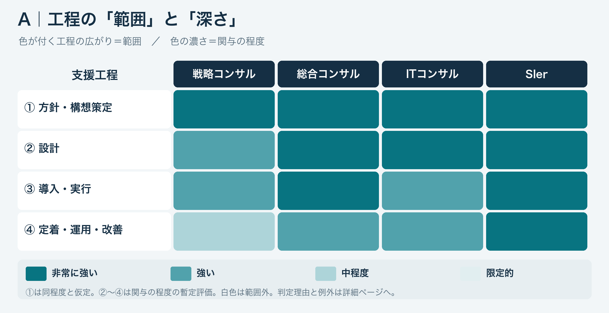
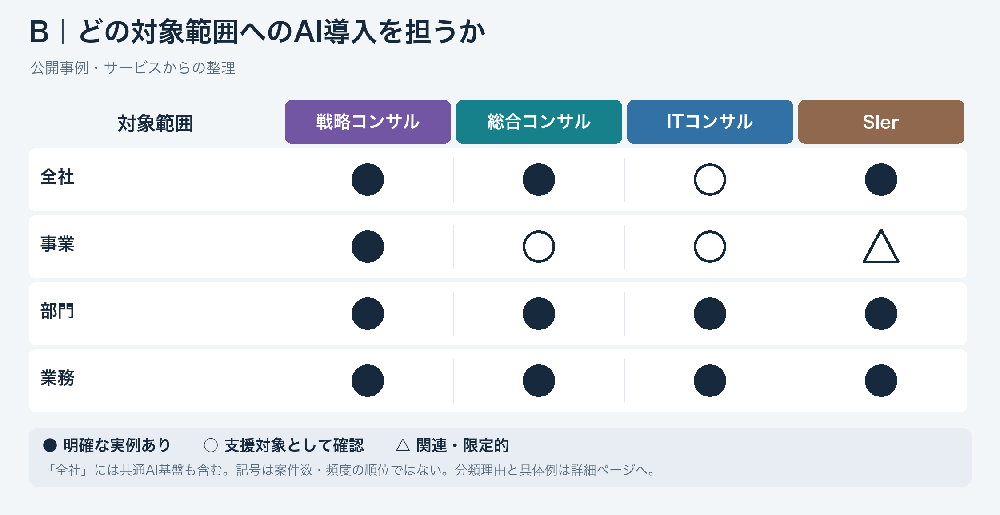

# AIアーキテクトに限定した2つの問い

確認・記録日：2026年11月6日。ここでは支援領域をAI・データに固定する。役職名の市場統計ではなく、顧客のAI導入・変革を支援する仕事の比較。正式募集職種の比較は今回実施していない。

## 問いA：どの工程を、どの程度担うか

### 本人と整理した評価方法

- **範囲**：①〜④のどの工程に関与するか。
- **深さ／関与の程度**：その工程にどれほど強く関わるか。
- ①への関与は同程度と仮定する。実測で等しいという結論ではない。
- 差を見る観点は、②の技術的な判断、③の実装への参加、④の稼働後の継続関与。
- ④は利用・組織への定着と、監視・品質評価・モデル更新・保守等の技術運用を分けて確認する。
- 外部ベンダーとの協働、自社以外の技術を使うこと自体は減点しない。自社内完結・自社製品保有の有無と、技術への関与の程度は別。

### 現在の図：同じ色の4段階

濃い順に、**4＝非常に強い、3＝強い、2＝中程度、1＝限定的**。白は範囲外、未確認は明記。色の付く工程の広がりが範囲、濃さが程度。役割の種類・ばらつき・確信度を濃淡に混ぜない。4は2の2倍という量ではない。

| 工程 | 戦略 | 総合 | ITコンサル | SIer |
| --- | --- | --- | --- | --- |
| ① 方針・構想策定 | 4 | 4 | 4 | 4 |
| ② 設計 | 3 | 4 | 4 | 4 |
| ③ 導入・実行 | 3 | 4 | 3 | 4 |
| ④ 定着・運用・改善 | 2 | 3 | 3 | 4 |

**各セルはCodexの比較用の暫定的所感**。本人が合意したのは比較方法・表現の方向で、実測平均・技術力順位・応募順位ではない。4段階化に伴う④の仮置きを含む。戦略系の専門組織にも深い設計・開発・技術運用の例があり、図の値は各社・部門の上限ではない。

範囲だけなら4カテゴリーで①〜④の事例・提供範囲が重なる。全社・部門が対応可能なことと、同一案件・同一個人がすべて担うことも別。各カテゴリーの実態・例外は[evidence.md](evidence.md)、詳細な色の理由は[Notionの問いA](https://app.notion.com/p/40f161f2809781baa997d046afb8e9f8)。

### 「深さに幅」と役割4分類を撤回した理由

「深さに幅」は企業・部門・案件による違いを指したが、程度の段階とばらつきを混ぜた。本人の指摘で撤回。「助言／支援・レビュー／直接参加／主導・中核」という段階案も、仕事の質・種類が異なるため採用しない。同じ観点への**程度**だけを段階化し、具体的な役割・ばらつきは詳細欄で説明する。

## 問いB：変革の対象範囲に違いはあるか

| 対象範囲 | 戦略 | 総合 | ITコンサル | SIer |
| --- | --- | --- | --- | --- |
| 全社 | ● | ● | ○ | ● |
| 事業 | ● | ○ | ○ | △ |
| 部門 | ● | ● | ● | ● |
| 業務 | ● | ● | ● | ● |

- **●**：今回の具体的な顧客事例で、対象範囲への支援を明確に確認。
- **○**：サービス・体制の説明などで支援対象として確認。
- **△**：関連・間接的な関与はあるが、対象自体の変革を示す根拠が限定的。

BはAの程度とは意味が違う。**Bの記号は案件比率・頻度・能力・インパクトの順位ではない**。今回のAの表示変更ではBを変更していない。

### 全社の何を変えるか

全社共通のAI配布・データ基盤・品質管理と、事業・業務・組織を一体で変える全社横断の変革を分ける。どちらも対象範囲は全社だが、変える中身が異なる。経営者が使う意思決定AIであることだけで全社変革には分類しない。

## 現状のトレンドと、確認できないこと

- 国内市場のIDC資料は、AIを背景に業務・データ基盤・組織を一体化する全社変革案件の増加、大型化、複数年化を報告する（M1）。
- 世界の企業のAI活用拡大を扱うMcKinsey調査（M2）や、活用と業務・組織再設計の速度差を指摘するBCG調査（M3）は、顧客側の動きの参考。
- **カテゴリー別にどの対象範囲の案件が最多か、全社案件が過半数かは未確認**。公開事例の掲載件数から比率を推計しない。
- 個別業務・部門の実装や全社共通基盤と、全社横断の変革が並行する。全社変革の拡大を、個別導入の消滅と読み替えない。
- 14事例は国内10・海外4。存在確認用の選定であり、代表標本ではない。海外の実績を国内28卒の応募・配属の証拠にはしない。

市場資料のURL・公開日・解釈限界と、事例の原文リンクは[evidence.md](evidence.md)に保存。

## 自己分析にどう接続するか：ここはまだ検討中

本人の関心は、現在の案件を知った上で将来のAIアーキテクト像を想定し、就活で目指す場所を考えること。単にインパクトが大きい案件を好むだけでなく、技術進展を見据えて合理的に方向性を考えたいという文脈。

「AI導入が普及すると導入専業の価値が下がるのでは」「AIと事業・全社戦略の接続が重要になるのでは」は本人の将来仮説。淘汰・需要予測の確定事実ではない。現在の①AI導入方針に関わることと、全社経営戦略へ関与することも同一視しない。

**11/6追補**：[理想の企業像](ideal-company-framework.md)を、①に軸足を置き②〜④へ関与し、全社変革を促せる環境へ具体化した。個人の可能性は構想と実装がつながる環境から間接評価する。企業の探索・適合判定は次の段階で、今回は未実施。将来の需要・役割の予測や関与の細かな配分は引き続き検討中。戦略コンサルなら両方満たす／SIerなら満たせないとは決めない。AIだけを担当して戦略の議論から離れる配置への懸念はあるが、コーディングやエンジニア職を一律に拒否した決定でもない。
