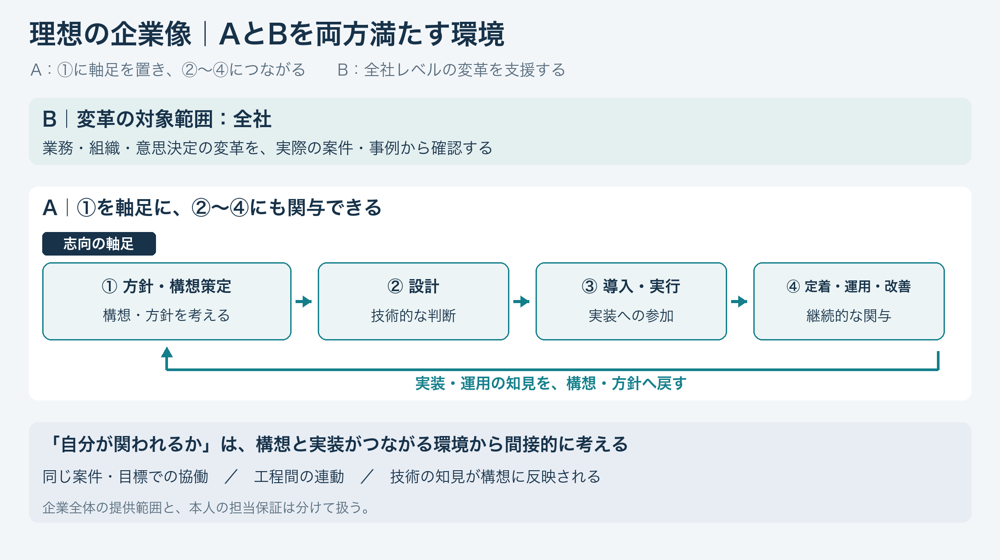

# 理想的な企業像：①を軸足に実装とつながり、全社変革を促す

整理日：2026年11月6日。本人の最新発言に基づく探索用のフレームワーク。**今回は企業探し・適合判定を始めていない。** [Notionの指定見出し](https://app.notion.com/p/40f161f280978009a9a0f7ba92ea2381)以下にも保存。機械可読版は[ideal-company-framework.json](ideal-company-framework.json)。

> ①方針・構想策定に軸足を置き、②設計・③導入実行・④定着運用改善との関与を通じて技術理解を深めながら、AIによる全社レベルの変革を促せる企業・環境。

## 1. A：①に軸足を置き、②〜④にも関与できる

本人の中心は構想・方針策定という①。技術への理解が必要だと考えるため、③④を含む②〜④への関与を通じて理解を深めたい。

①〜④を均等に担当する希望でも、実装専業へ軸足を移す決定でもない。既存Aの各セルを一律に最大へする希望とは読み替えない。会社を見るときも自分の仕事を考えるときも、「①を軸足に、②〜④とつながれるか」が中心。

旧Aで①を同程度としたのは比較上の仮定で、各企業の①の深さ・実績が等しいという事実の確認ではない。

## 2. 個人の可能性は、構想と実装がつながる環境から間接的に考える

企業全体の活動と、本人が担当できる仕事は区別する。一方、公式情報だけで個人の仕事を直接確定するのは難しい。理想像を企業単位で評価する段階では、**①と②〜④が接続する環境か**を主な手がかりにし、本人も両方へ関われる可能性を間接的に考える。

今後の調査で確かめる情報の例：

| 見るもの | 確認したいこと |
| --- | --- |
| 同じ案件・共通の目標 | 構想・業務・技術の担当者が協働しているか |
| 工程間の連動 | ①の目的・判断が②〜④につながっているか |
| 技術的な知見の反映 | 実装・運用の知見が構想や方針へ戻るか |
| 部門をまたぐ協働 | 組織が分かれていても案件・意思決定の場でつながるか |

上記は本人の希望を調査可能な観点へ具体化したもの。構想・実装の両機能の存在だけでは、接続や個人の担当は確定しない。同じ部署、または一人による全工程担当を必須としない。個人の担当・配属の保証を示す公式情報を、この段階の候補評価の必須条件にはしない。情報不足は未確認として残す。

## 3. B：全社レベルの変革を促せる環境かを、案件・事例から考える

会社紹介だけでなく、過去の具体的な案件で何をしてきたかを根拠にする。

| 確認項目 | 見る内容 |
| --- | --- |
| 目的 | 顧客の全社方針・課題、AIを使う狙い |
| 対象 | どの事業・部門・業務・共通基盤・組織・意思決定を変えるのか |
| 活動 | 構想・設計・実装・展開・定着・運用で何を担ったか |
| 進行状態 | 構想・PoC・本番・展開中・定着等の状態 |

全社共通のAI配布・基盤整備と、業務・組織・意思決定を含む全社横断の変革を分ける。共通基盤も根拠として扱い、どのように全社の変革へつながるかを見る。構想中・進行中と完了実績を区別する。完了案件だけを条件にはしない。

## 4. 今後使うフレームワーク

**①に軸足 × ②〜④との接続 × 全社変革の事例。**

- Aの仕事像：①を中心に、技術理解につながる②〜④への関与があるか。
- Aの環境：構想と実装が、同じ案件・課題・意思決定の下でつながるか。
- Bの環境：全社レベルの変革を支援してきた具体的な活動・事例があるか。

会社名・カテゴリーだけで合否を出さず、案件・体制を根拠に企業環境を評価する。個人の可能性は環境からの推定として扱う。現時点で新しい企業リスト・評価点数・志望順位は作っていない。

既存の候補条件（日本28卒・大学院生向け入口、AI側SIer除外、総合Big4＋Accenture等）は別に継続する。理想像の整理と、現実の応募入口を確認する段階を混同しない。
